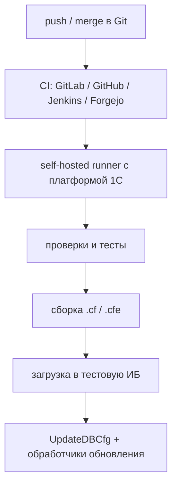

1C CI/deploy workflow уже оформился. В 2026 году типовая схема такая:



Никакого специального демона внутри 1С, который сам следит за Git, обычно нет. Push запускает CI, а runner вызывает штатные CLI платформы или их удобную обёртку.

### Главный стандартный инструмент — Vanessa Runner

[`vanessa-runner`](https://github.com/vanessa-opensource/vanessa-runner) — фактически сложившийся стандарт автоматизации 1С: сборка `.cf/.cfe`, загрузка исходников, обновление ИБ, запуск тестов и работа с хранилищем. Он одинаково запускается локально и в CI.

Для новой версии 3.0 команда выглядит так:

```bash
vrunner infobase update \
    --src ./src/cf \
    --ibconnection '/Sserver\database'
```

Она загружает исходники в конфигурацию и обновляет конфигурацию БД. Поддерживаются:

* XML-выгрузка Конфигуратора;
* EDT-проект;
* готовый `.cf`;
* файловые и серверные ИБ;
* Конфигуратор либо `ibcmd`.

[Документация `infobase update`](https://autumn-library.github.io/vanessa-runner/%D0%BA%D0%BE%D0%BC%D0%B0%D0%BD%D0%B4%D1%8B/infobase) прямо описывает загрузку нового источника и `UpdateDBCfg`.

Но есть нюанс: ветка 3.0 сейчас новая и несовместимая с предыдущей. Авторы пока рекомендуют для production закреплять LTS `2.6.1`; там эквивалентная команда:

```bash
vrunner update-dev \
    --src ./src/cf \
    --ibconnection '/Sserver\database'
```

То есть я бы сейчас сделал так:

* для консервативной боевой автоматизации — pin `vanessa-runner@2.6.1`;
* для нового проекта — испытать 3.0 на тестовой базе и только потом закрепить конкретную версию, не ставить плавающий `latest`.

### Что находится под Git

Есть три разумных варианта.

| Формат в Git                    | Где применяют              | Моя оценка                                 |
| ------------------------------- | -------------------------- | ------------------------------------------ |
| Иерархический XML Конфигуратора | Классический 1С-dev и CI   | Самый надёжный и простой для автоматизации |
| Нативный проект EDT             | Разработка полностью в EDT | Современнее, но CI тяжелее                 |
| `.cf/.cfe`                      | Только артефакт сборки     | Не исходники, а результат pipeline         |

EDT официально ориентирован на Git и даже умеет связывать разные ветки с разными информационными базами. [1С прямо описывает такой workflow](https://edt.1c.ru/docs/intro/features3.php).

Но платформа не читает формат EDT непосредственно: сначала нужен `1cedtcli`, превращающий EDT-проект в обычный XML, а затем уже загрузка платформой. Vanessa Runner 3 умеет делать это самостоятельно: [описание поддержки EDT](https://autumn-library.github.io/vanessa-runner/%D0%BA%D0%BE%D0%BC%D0%B0%D0%BD%D0%B4%D1%8B/edt). При этом `1cedtcli` довольно тяжёлый и ещё имеет реальные CI/headless-баги даже в версиях 2025–2026, например [регрессию headless import](https://github.com/1C-Company/1c-edt-issues/issues/2245). Если EDT вам сам по себе не нужен, для чистого agentic/CI workflow я бы выбрал XML Конфигуратора.

### Что делает runner на push

Практически правильная конфигурация:

1. Push в feature branch — анализ и тесты, без обновления общей базы.
2. Merge в `develop` — автоматическое обновление общей dev/test ИБ.
3. Tag/release — сборка неизменяемого `.cf/.cfe`.
4. Stage/prod — развёртывание именно собранного артефакта, желательно с ручным approval.

На runner:

```bash
git checkout "$CI_COMMIT_SHA"

bsl-language-server --analyze --srcDir ./src/cf

vrunner cf compile \
    --src ./src/cf \
    ./build/application.cf

vrunner infobase update \
    --src ./build/application.cf \
    --ibconnection "$IB_CONNECTION"
```

[`BSL Language Server`](https://1c-syntax.github.io/bsl-language-server/) — стандартный статический анализатор BSL. Для модульных тестов сейчас разумно смотреть на [`YAxUnit`](https://bia-technologies.github.io/yaxunit/), для сценарных/UI — [`Vanessa Automation`](https://github.com/Pr-Mex/vanessa-automation).

Runner должен быть self-hosted — Windows либо Linux-машина с нужной версией платформы, доступом к ИБ и соответствующим окружением. GitHub/GitLab/Forgejo лишь ставят job в очередь.

### Можно обойтись вообще без Vanessa Runner

Под ним лежит официальный пакетный интерфейс Конфигуратора:

```bash
1cv8 DESIGNER \
    /S 'server\database' \
    /N ci-user \
    /LoadConfigFromFiles ./src/cf \
    /UpdateDBCfg \
    /DisableStartupDialogs \
    /DisableStartupMessages \
    /Out ./build/deploy.log
```

Платформа официально поддерживает `/LoadConfigFromFiles` и `/UpdateDBCfg`; также существуют `-files`/`-listFile` для выборочной загрузки. [Документация пакетного режима](https://1c-dn.com/1c_enterprise/designer_batch_mode/).

Есть и официальный `ibcmd`:

```bash
ibcmd infobase config import ...
ibcmd infobase config apply ...
```

Он особенно интересен для headless Linux и автоматизации без GUI Конфигуратора. Но он требует параметров СУБД и работает ближе к кишкам базы, поэтому для первого production-конвейера я бы оставил Vanessa Runner поверх обычного Designer, а `ibcmd` включал после отдельного тестирования. Официальная документация подтверждает раздельные стадии [`config import`](https://kb.1ci.com/1C_Enterprise_Platform/Guides/Administrator_Guides/1C_Enterprise_8.3.24_Administrator_Guide/Chapter_7._Standalone_server/7.4._Examples_of_managing_and_starting_the_standalone_server/7.4.13._Dumping_configurations_to_files_Loading_configurations_from_files/) и [`config apply`](https://kb.1ci.com/1C_Enterprise_Platform/Guides/Administrator_Guides/1C_Enterprise_8.3.23_Administrator_Guide/7._Standalone_server/7.4._Examples_of_managing_and_starting_the_standalone_server/7.4.5._Load_configuration_from___.cf__file/).

### Важные грабли

* Деплой в одну ИБ обязательно сериализовать: два одновременных push не должны параллельно запускать обновление.
* Делать checkout точного SHA в чистый каталог, а не вечный `git pull`.
* Инкрементальную загрузку использовать только с сохранением состояния последнего успешно развёрнутого commit. При любой неопределённости — полная загрузка.
* `UpdateDBCfg` обновляет структуру базы, но не заменяет прикладные обработчики обновления БСП. Если конфигурация их использует, после этого нужен отдельный запуск режима Предприятия.
* `GitSync` здесь не нужен: он преимущественно выгружает версии из старого хранилища 1С в Git, то есть решает обратную задачу. [Это прямо видно из его описания](https://github.com/oscript-library/gitsync).
* В prod не стоит деплоить каждый случайный push. Автоматический push→deploy нормален для dev/test; production — только из защищённой ветки или тега, с backup и сохранённым `.cf`.

Итого: для вашей задачи я бы взял **иерархический XML → Git → Forgejo/GitLab runner → Vanessa Runner 2.6 LTS → dev-ИБ**, а после стабилизации проверил переход на Runner 3 и `ibcmd`. Это уже не кустарщина, а наиболее оформленный стандартный 1С-конвейер.
